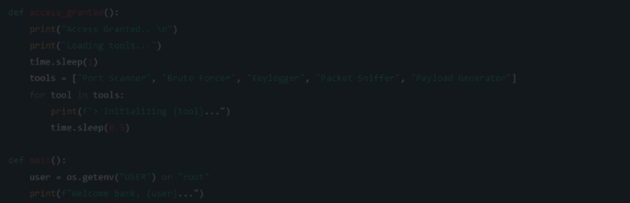

<p align="center">
  
</p>

<div align="center">

[](https://git.io/typing-svg)


</div>

---

## 🧑‍💻 `whoami`

```python
class Shreyash:
    role      = "Cybersecurity Enthusiast 🔐"
    exploring = ["AI 🤖", "Automation ⚙️", "Ethical Hacking 🕵️"]
    motto     = "Breaking bugs, building dreams 🛠️"
    mindset   = "Always curious, forever learning 📚"
    open_to   = "Teaming up for something impactful 🤝"

    def run(self):
        while True:
            self.learn()
            self.hack_ethically()
            self.build()
```

<br>

## 🎯 Focus Areas

<div align="center">

| 🔐 Security | 🤖 AI & Automation | 🛠️ Building |
|:---:|:---:|:---:|
| Ethical hacking<br>Bug hunting<br>Network security | Smart workflows<br>Python scripting<br>AI-powered tools | Cloud & APIs<br>Embedded / IoT<br>Web projects |

</div>

<br>

## 💻 Tech Stack

<div align="center">

**Languages**<br>


**Cloud & Databases**<br>


**Tools & Hardware**<br>


</div>

<br>

## 📊 GitHub Stats

<div align="center">


</div>

<br>

## 🏆 Trophies

<div align="center">


</div>

<!--
🐍 Optional: animated contribution snake
Add the "Platane/snk" GitHub Action to this repo, then uncomment:

<div align="center">
  
</div>
-->

<br>

## 🌐 Let's Connect

<div align="center">

[](https://instagram.com/shreyash.rakhunde)
[](https://linkedin.com/in/shreyashrakhunde96)
[](mailto:shreyashrakhunde96@gmail.com)

<br>

> 💬 *"Security is not a product, it's a process."*

</div>


